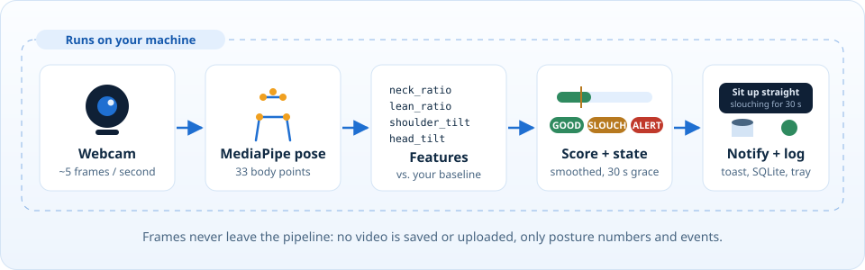
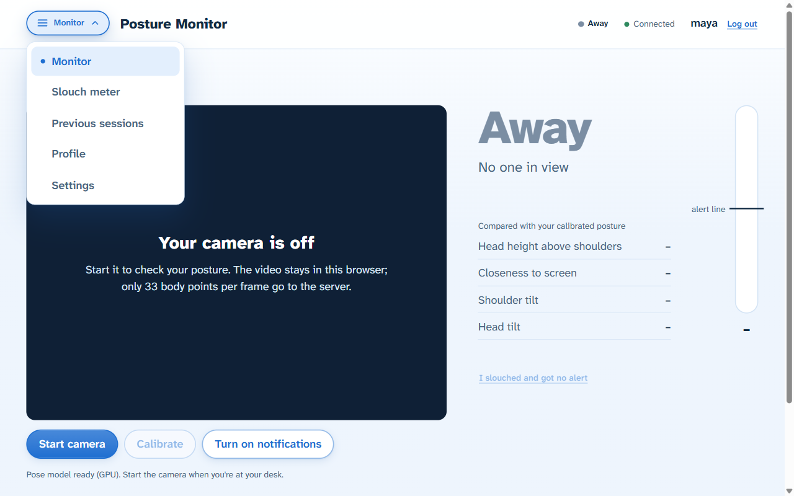
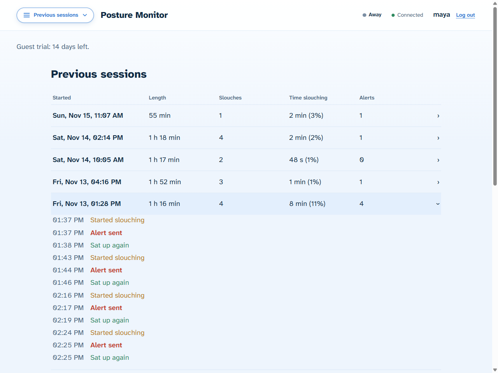
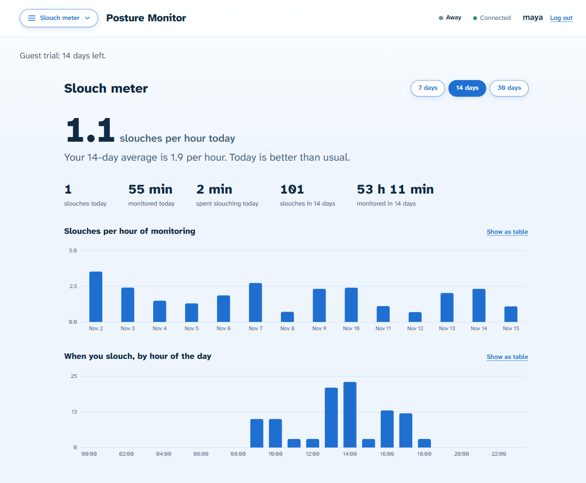
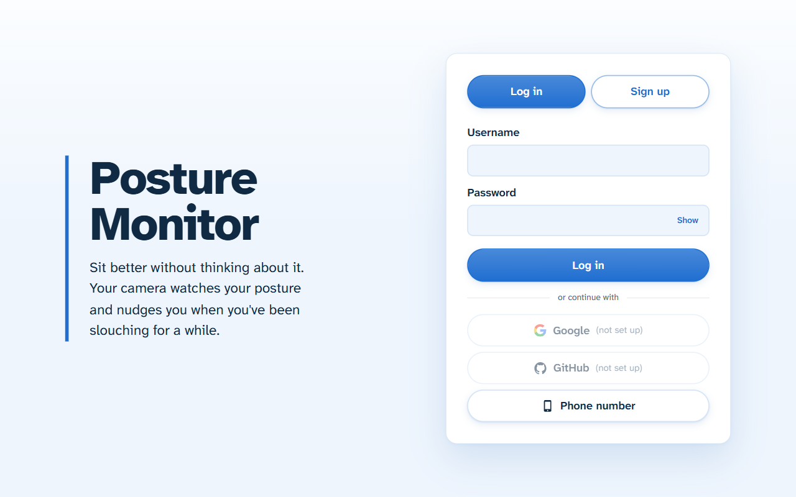
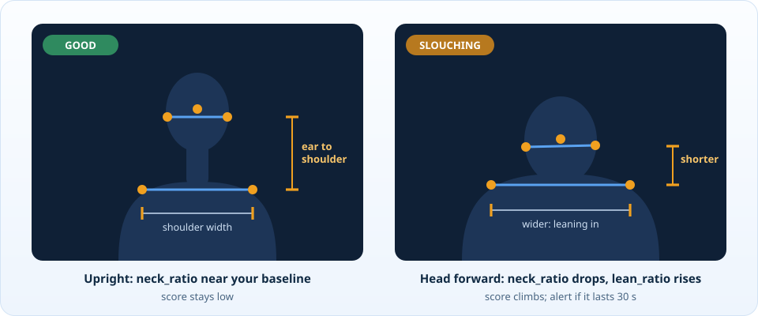
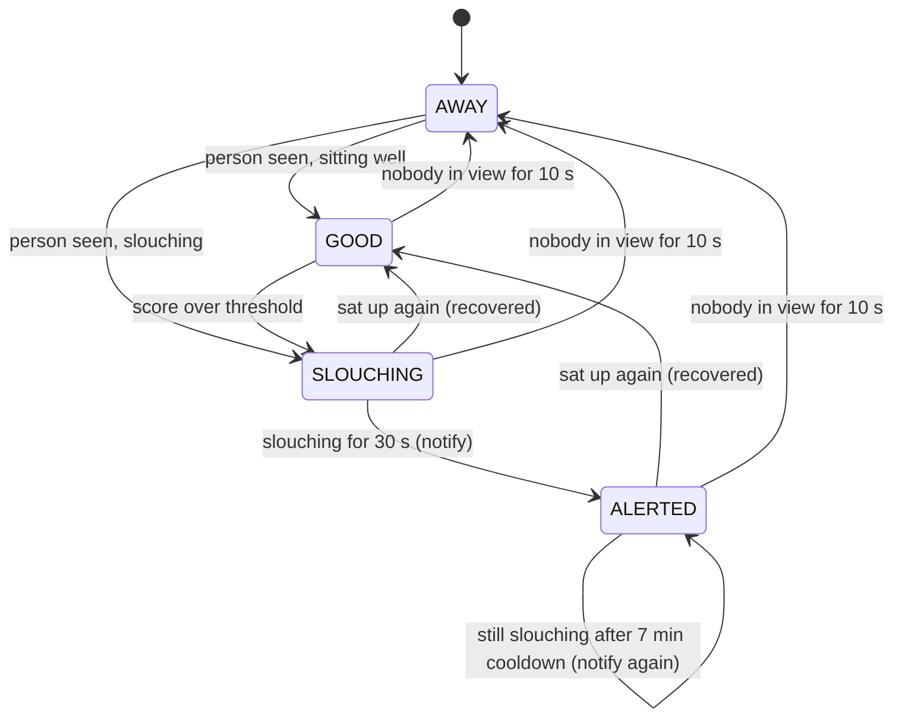

# Posture Monitor

Privacy-first, real-time posture monitor. It uses your webcam and on-device pose
estimation (MediaPipe) to spot slouching and notifies you if it lasts. Use it as a
Windows background app with a tray icon, or in the browser. No frames are saved or
uploaded; only posture numbers and events are kept, on your machine.

<p align="center">
  
</p>

**Jump to:** [Screenshots](#screenshots) · [Web app](#web-app) ·
[Quick start](#quick-start-windows) · [How it works](#how-it-works) ·
[Commands](#commands) · [Status](#status) · [Results](#results)

## Screenshots

<table>
  <tr>
    <td width="50%"><a href="docs/images/monitor.png"></a></td>
    <td width="50%"><a href="docs/images/sessions.png"></a></td>
  </tr>
  <tr>
    <td align="center"><b>Monitor</b>: live state, score meter and the menu</td>
    <td align="center"><b>Previous sessions</b>: click one to see its timeline</td>
  </tr>
</table>

**Slouch meter**: how often you slouch, day by day and by hour of the day. This
image follows your GitHub theme, so switch between light and dark to see both.

<a href="docs/images/slouch-meter.png">
<picture>
  <source media="(prefers-color-scheme: dark)" srcset="docs/images/slouch-meter-dark.png">
  
</picture>
</a>

<details>
<summary><b>Login page</b> (click to open)</summary>
<br>

</details>

The screenshots use a demo account with two weeks of made-up sessions. The camera
is off in them because the app never stores camera frames.

## Web app
```powershell
python -m backend        # then open http://127.0.0.1:8000
```
Sign up with Google, GitHub or a phone code (or as a 14-day guest), log in with
your username and password, then start the camera. The browser runs the pose model
itself and sends only 33 body points per frame to the server (`backend/`), which
scores your posture with the same engine as the desktop app. The page (`frontend/`)
shows your state, a score meter and alerts, with a dropdown menu for your slouch meter
(how often you slouch, by day and hour), previous sessions, profile and settings.
Each account has its own calibration and history. Google, GitHub and SMS need keys in `.env`; see
[docs/usage.md](docs/usage.md#setting-up-google-github-and-sms).

## Quick start (Windows)
```powershell
powershell -ExecutionPolicy Bypass -File scripts\setup.ps1
.\venv\Scripts\Activate.ps1
python -m src.main --calibrate   # sit upright: 3 s countdown, 5 s recording
python -m src.main --debug       # live skeleton, score and state
scripts\run.ps1                  # run in the background with a tray icon
```

## How it works
webcam (~5 FPS) -> MediaPipe PoseLandmarker -> neck/lean/tilt features compared
with your baseline -> smoothed score -> state machine (alert only after 30 s of
slouching, at most once per 7 min) -> notification + SQLite log + tray icon.
See [docs/architecture.md](docs/architecture.md).

<p align="center">
  
</p>

Every measurement is divided by your shoulder width, so sitting nearer or further
from the camera doesn't change it. Only the harmful direction counts: dropping your
head or leaning in raises the score; sitting taller doesn't.

<details>
<summary><b>State machine</b> (click to open; drag or zoom the diagram on GitHub)</summary>



Short slouches, like glancing at your phone, never alert. Recovery needs the score
to fall clearly below the line, so a score hovering at the edge doesn't flicker.
The numbers above are the defaults in `config/settings.json`.
</details>

## Commands
| Command | What it does |
|---|---|
| `python -m backend` | web app at http://127.0.0.1:8000 (`--port` to change) |
| `python -m src.main` | background mode with a tray icon (Pause, Recalibrate, Quit) |
| `python -m src.main --debug` | console + live window; press `s` to save landmarks as an example |
| `python -m src.main --calibrate` | record a new upright baseline |
| `python -m src.main --video data\input\clip.mp4` | run on a recorded video instead of the webcam |
| `python -m src.main --label` | labelled session: `y`/`n` after each alert, `m` for a missed slouch |
| `python scripts\benchmark.py` | measure CPU, latency and FPS into docs/benchmarks.md |
| `pytest -q` | run the tests |

Settings are in `config/settings.json`; override any of them per machine in
`.env` (see `config/env.example`). More in [docs/usage.md](docs/usage.md).

## Status
All five build phases and the web app are done, and a code review fixed 16 problems; 124 tests pass. What's been
checked and what's left: [docs/progress.md](docs/progress.md).

## Results
About 0.5% CPU and 12 ms per frame at 5 FPS on a Ryzen 7 5800H, measured so far
with nobody in frame, so expect somewhat more while it tracks you. Full numbers and
method: [docs/benchmarks.md](docs/benchmarks.md).
