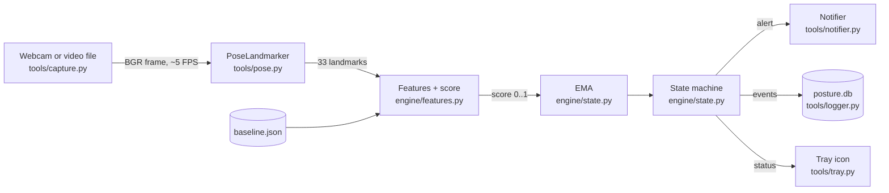
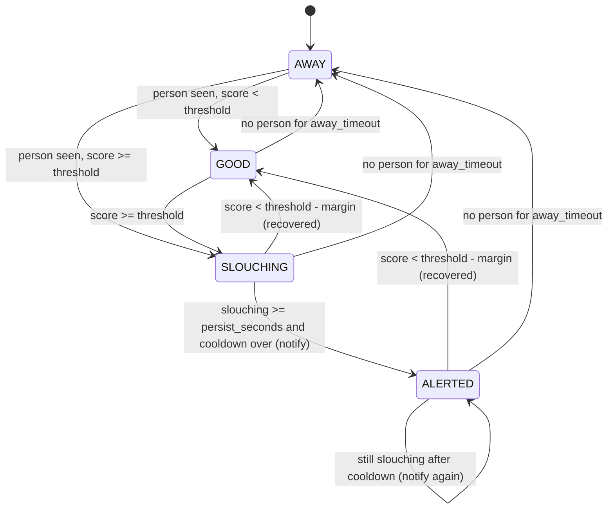
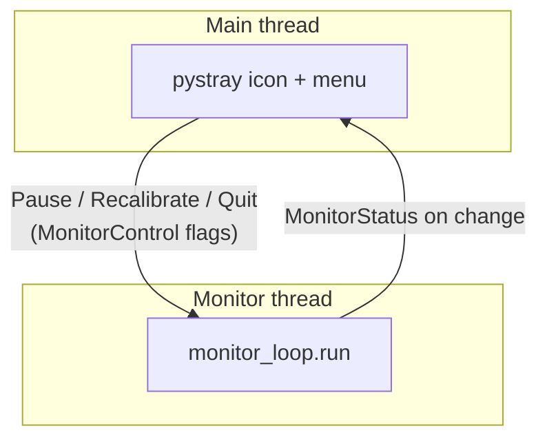

# Architecture

Posture Monitor runs entirely on the local machine. A webcam frame goes through
MediaPipe pose estimation, becomes a handful of numbers, and only those numbers move
on. Frames are never written to disk or sent anywhere.

## Pipeline

Per frame (`workflows/monitor_loop.py`):

1. **Throttle** (`utils/timing.FrameThrottle`) waits for the next slot at
   `process_fps`, sleeping instead of spinning so the CPU stays idle in between.
2. **Capture** reads the newest frame. The camera buffer is kept at one frame so
   it's never stale; a video file skips ahead to the frame that should be on screen.
3. **Pose** runs `PoseLandmarker` in `VIDEO` mode with a strictly increasing
   timestamp, which lets MediaPipe track between frames instead of re-detecting.
4. **Features** (`engine/features.py`) turn the ears and shoulders into four numbers,
   all divided by shoulder width so distance from the camera cancels out:
   `neck_ratio`, `lean_ratio`, `shoulder_tilt`, `head_tilt`.
5. **Score**: each feature's deviation from the baseline is mapped to 0..1 and
   weighted (`weights` in settings). Only harmful directions count: a head that
   drops or leaning in raises the score; sitting taller or leaning back doesn't.
6. **EMA** smooths the score so one noisy frame can't change state.
7. **State machine** decides whether to alert (below).
8. **Side effects**: notification, SQLite event, tray status, debug overlay.

## State machine

- **Persistence** (`persist_seconds`): short slouches, like glancing at a phone, never alert.
- **Cooldown** (`cooldown_minutes`): at most one alert per cooldown, even across
  recover/slouch cycles and pauses.
- **Hysteresis** (`recovery_margin`): recovery needs the score to fall clearly below
  the threshold, so a score hovering at the line doesn't flap.
- **Away**: short gaps in detection keep the current state; only a gap of
  `away_timeout_seconds` counts as leaving the desk and resets the slouch timer.
- Time is passed in, so tests simulate hours of posture in milliseconds.

## Calibration

`workflows/calibrate_flow.py` shows a preview with a countdown, then records
`calibration_seconds` of frames where the ears and shoulders are clearly visible.
The baseline is the **median** of each measurement (`engine/calibration.py`), so a
few bad frames don't skew it. It's saved to `data/output/baseline.json`.

## Threads in background mode

`python -m src.main` (what `scripts\run.ps1` starts with `pythonw.exe`) runs the
tray on the main thread, because Windows needs the icon's message loop there, and
the monitor loop on a worker thread. They share only `MonitorControl`: thread-safe
stop, pause and recalibrate flags one way, and a frozen `MonitorStatus` the other
way, published only when it changes. Pause releases the camera so its light goes off.
Recalibrate runs the calibration window on the worker thread and then carries on.

## Layers

| Folder | Role | Rule |
|---|---|---|
| `src/engine/` | features, calibration, state machine | pure logic: no camera, files or OS calls |
| `src/utils/` | geometry, throttle/latency stats, `.env` parsing | pure |
| `src/schemas/` | dataclasses and enums shared by every layer | data only |
| `src/tools/` | camera/video, MediaPipe, notifications, SQLite, tray, example files | all I/O lives here |
| `src/workflows/` | monitor loop, calibration flow | wires tools and engine together |
| `src/main.py` | CLI flags, settings loading, logging | entry point |

Keeping `engine/` and `utils/` pure means almost all behaviour is tested with
fake landmarks and a fake clock, without a camera.

`src/schemas/` would naturally be called `types/`, but a package with that name
hides Python's standard `types` module and can break imports at startup.

## Configuration

Every threshold and tunable lives in `config/settings.json`. Top-level keys can be
overridden per machine: environment variables win over a `.env` file in the
project root, which wins over the JSON (`utils/env.py`), for example
`CAMERA_INDEX=1`. Notification texts are in `messages/alerts.json` and rotate.

## Data

All runtime data is in `data/output/` (gitignored):

| File | Contents |
|---|---|
| `baseline.json` | calibrated upright posture |
| `posture.db` | `sessions` (start/end, avg CPU %, avg latency), `events` (`slouch_start`, `alert`, `recovered`, `away` with score), `labels` (`correct`, `false_alarm`, `missed`) |
| `app.log` | background-mode log |

`data/examples/` holds labelled landmark files (coordinates only) used by the
tests; `data/input/` (gitignored) is for your own recorded test videos.

## Testing and measurement

- `pytest -q` covers geometry, features, calibration, the state machine (simulated
  time), the full pure pipeline on fake poses, the landmark examples, video input,
  the logger, tray status, `.env` overrides, and that every settings key the code
  reads exists.
- `python scripts\benchmark.py` measures CPU, latency and FPS on the real pipeline
  and writes `docs/benchmarks.md`. `--video` makes runs repeatable.
- `python -m src.main --label` records whether each alert was right, so the
  benchmark can report alert precision.
